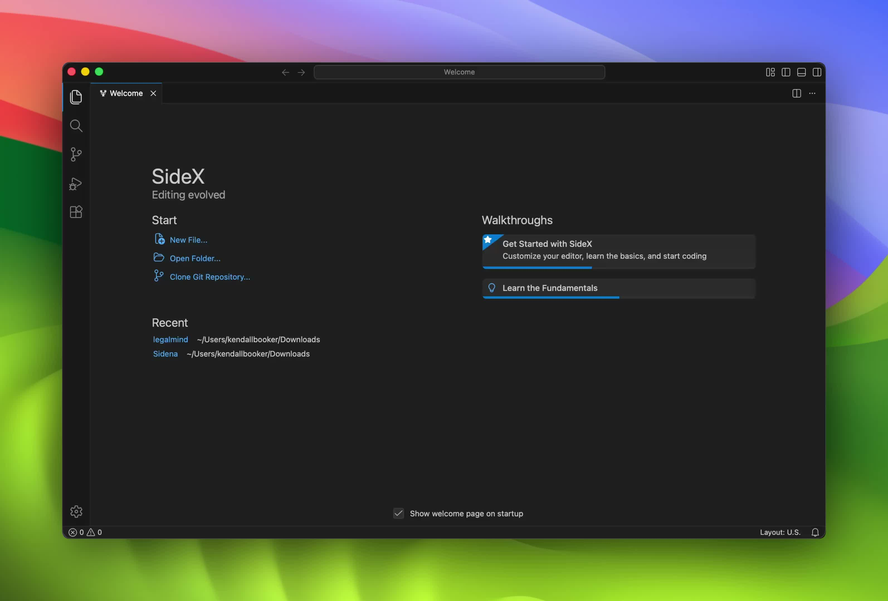
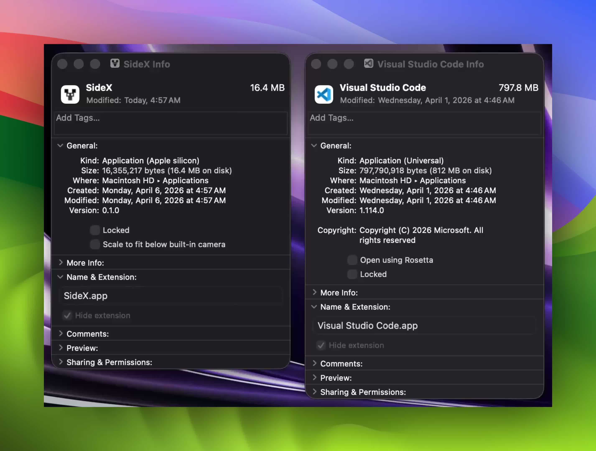

<h1 align="center">SideX</h1>

<p align="center">
  <strong>VSCode's workbench, without Electron.</strong>
</p>

<p align="center">
  <a href="https://discord.gg/8CUCnEAC4J"></a>
  <a href="https://github.com/Sidenai/sidex/issues"></a>
  <a href="LICENSE"></a>
  
</p>

<br>

<p align="center">
  
</p>

<br>

<p align="center">
  <a href="#why">Why</a> · <a href="#whats-working">What's Working</a> · <a href="#ai-agent">AI Agent</a> · <a href="#getting-started">Getting Started</a> · <a href="#how-its-built">How It's Built</a> · <a href="#contributing">Contributing</a> · <a href="https://discord.gg/8CUCnEAC4J">Discord</a>
</p>

---

SideX is a port of Visual Studio Code that replaces Electron with [Tauri](https://tauri.app/) — a Rust backend and OS's native webview. The same TypeScript workbench, the same editor, terminal, and Git integration, running without a bundled browser.

> **Early release.** Core editing and the terminal are solid. The extension host and debugger are still in progress. See [What's Working](#whats-working) for the full picture.

---

## Why

VSCode's memory useage is almost entirely from its bundled Chromium, not the editor itself. Tauri replaces that with the webview already on your system — WKWebView on macOS, WebView2 on Windows — shared across apps and costing almost nothing extra.

<p align="center">
  
</p>

RAM savings are most tested on macOS, WKWebView is shared with Safari. On Windows the picture is more nuanced — WebView2 memory can look higher depending on how it's measured, and [it's an active area in the Tauri ecosystem](https://github.com/tauri-apps/tauri/issues/5889). The target is **under 200 MB at idle** on macOS. We'll publish real benchmarks once the app is stable enough for them to be meaningful.

---

## What's Working

**Solid:**

- Monaco editor with syntax highlighting and basic IntelliSense
- File explorer — open folders, create, rename, delete
- Integrated terminal — full PTY via Rust, shell detection, resize, signals
- Git — status, diff, log, stage, commit, branch, push/pull/fetch, stash, reset
- Themes — multiple built-in themes from the VSCode catalogue
- Native OS menus (macOS, Windows, Linux)
- Extension installation from [Open VSX](https://open-vsx.org/)
- File watching, file search, full-text search, Rust-backed search index
- SQLite storage, document management (autosave, undo/redo, encoding)
- Built-in AI agent — chat, inline diffs, shell commands, multi-file edits; bring your own model provider, no account needed (see [AI Agent](#ai-agent))

---

## AI Agent

SideX has a built-in coding agent, and it needs no SideX account of any kind — no sign-in, no identity provider, no hosted service in the path. Every request goes from the editor to a server running on your own machine, and from there straight to whichever model provider you point it at.

### How it starts

On launch, the app spawns its own agent server (`sidexai/sidex-server`, written in Go) as a child process bound to `127.0.0.1` on a random free port. It's supervised from [`src-tauri/src/server.rs`](./src-tauri/src/server.rs) and stopped when the app exits. If the server binary isn't built, the rest of the editor still works — the chat panel just reports itself as disconnected.

### Bring your own model

There are no built-in model presets. You add a provider and a model ID yourself in **Settings → Models**. Credentials are resolved in this order, first match wins (see [`src-tauri/src/commands/providers.rs`](./src-tauri/src/commands/providers.rs)):

1. a key entered in **Settings → Models**
2. an environment variable already in your shell (`ANTHROPIC_API_KEY`, `OPENAI_API_KEY`, and so on — see [`.env.example`](./.env.example) for the full list)
3. an existing **Claude Code** or **Codex** CLI login on your machine, opt-in per provider
4. a keyless local model server on loopback — Ollama, LM Studio, llama.cpp, or vLLM — detected automatically

Anthropic is called through its native Messages API (`/v1/messages`); every other provider, including local servers, is treated as OpenAI-compatible (`/chat/completions`).

Credentials reach the agent server only through its process environment (`SIDEX_PROVIDER_<PROVIDER>_KEY` / `_BASE_URL` / `_AUTH`), set fresh each time the app starts or restarts it. They're never written to a config file and never sent to the webview.

> **Claude Code / Codex CLI logins** are optional, per provider, and off by default. SideX talks to Anthropic and ChatGPT with the same first-party client identity those CLIs use, so a connected login can run models. Usage still counts against that subscription. A billed API key in Settings → Models is the path that does not depend on a CLI login or the provider's consumer terms.

### Security: this server runs commands on your machine

The agent server executes shell commands and edits files on your behalf — that's what lets it act as an agent. Binding it to `127.0.0.1` only is a deliberate security boundary, not an accident: nothing else on your network can reach it.

`SIDEX_BIND_ADDR` can widen that if you need to, but the server refuses to start on a non-loopback address unless you explicitly opt in with `SIDEX_ALLOW_UNAUTHENTICATED=1`. Don't set that unless you understand the exposure and have your own authentication sitting in front of it — an open port on this server means arbitrary code execution for whoever can reach it.

### Building the agent server

The agent server needs **Go 1.26 or later** to build (see [`sidexai/sidex-server/go.mod`](./sidexai/sidex-server/go.mod)):

```bash
cd sidexai/sidex-server
go build -tags fts5 -o sidex-server ./cmd/server
```

The app looks for a binary at that path automatically when running from a source checkout. Without it, everything except the chat panel works normally. See [`sidexai/sidex-server/.env.example`](./sidexai/sidex-server/.env.example) if you'd rather run the server yourself instead of letting the app manage it.

---

## Getting Started

### Run in Development

```bash
git clone https://github.com/Sidenai/sidex.git
cd sidex
npm install
npm run tauri dev
```

### Build from Source

```bash
npm install
npx tauri build
```

`npx tauri build` runs the frontend build for you (`npm run build`), which already raises Vite's Node heap limit to 12 GB internally — no `NODE_OPTIONS` needed on a normal machine. If you still hit an out-of-memory error, raise it further yourself with `NODE_OPTIONS="--max-old-space-size=16384"` before the command.

First build takes 5–10 minutes (Rust compile time). Pre-built binaries are not distributed yet.

Everything above runs standalone, with no account and no setup. Want the chat panel connected too? See [AI Agent](#ai-agent) above — building the agent server is a separate, optional step.

---

## NixOS

The repository includes a Nix flake that packages the Linux application with
the official `cargo-tauri` hook. With flakes enabled:

```bash
nix run github:QexleOSS/sidex
```

To build the package locally instead:

```bash
nix build github:QexleOSS/sidex
./result/bin/SideX
```

For development dependencies, enter the included shell:

```bash
nix develop github:QexleOSS/sidex
```

The package currently includes the main application only. Extensions and
language servers can be installed separately from Open VSX at runtime.

---

## How It's Built

SideX maps VSCode's Electron architecture onto Tauri layer by layer:

| VSCode (Electron) | SideX (Tauri) |
|---|---|
| Electron main process | Tauri Rust backend |
| `BrowserWindow` | `WebviewWindow` |
| `ipcMain` / `ipcRenderer` | `invoke()` + Tauri events |
| Node.js `fs`, `pty`, etc. | Rust commands (`std::fs`, `portable-pty`) |
| Menu / Dialog / Clipboard | Tauri plugins |
| Renderer (DOM + TypeScript) | Same — runs in native webview |
| Extension host | Sidecar process (in progress) |

The TypeScript frontend is a direct port of VSCode's workbench. The Rust backend is in `src-tauri/src/commands/` and handles everything that would have been a Node.js native module: file I/O, terminal PTY, Git, file watching, search indexing, SQLite, and process management.

### Project Layout

```
sidex/
├── src/                    # TypeScript workbench (ported from VSCode)
│   └── vs/
│       ├── base/           # Core utilities
│       ├── platform/       # Platform services and dependency injection
│       ├── editor/         # Monaco editor
│       └── workbench/      # IDE shell, panels, features, contributions
├── src-tauri/              # Rust backend
│   └── src/
│       ├── commands/       # fs, terminal, git, search, debug, providers, etc.
│       ├── server.rs       # Supervises the local agent server
│       ├── lib.rs          # App setup and command registration
│       └── main.rs         # Entry point
├── sidexai/sidex-server/   # Go agent server (chat, tools, MCP, memory)
├── crates/                 # Rust support crates — agent tools, context engine, git, LSP, DAP, terminal, extensions, and more
├── index.html
├── vite.config.ts
└── package.json
```

### Tech Stack

| Layer | Technology |
|---|---|
| Frontend | TypeScript, Vite 6, Monaco Editor |
| Terminal UI | xterm.js + WebGL renderer |
| Syntax / Themes | vscode-textmate, vscode-oniguruma (WASM) |
| Backend | Rust, Tauri 2 |
| Terminal | portable-pty (Rust) |
| File watching | notify crate (FSEvents on macOS) |
| Search | dashmap + rayon + regex (parallel, Rust) |
| Storage | SQLite via rusqlite |
| Extensions | Open VSX registry |
| Agent server | Go, own process on loopback ([`sidexai/sidex-server`](./sidexai/sidex-server)) |

For a deeper dive, see [ARCHITECTURE.md](./ARCHITECTURE.md)

---

## Contributing

This was released early to get outside contributors involved.

### How to Contribute

1. Fork the repo and create a branch
2. Pick something — check [Issues](https://github.com/Sidenai/sidex/issues) or grab something from the Known Gaps list above
3. Submit a PR — contributors get credited

### Dev Notes

- Follows VSCode's patterns — familiar if you've read the VSCode source
- TypeScript imports use `.js` extensions (ES module convention)
- Services use VSCode's `@inject` dependency injection decorators
- New Rust commands go in `src-tauri/src/commands/` and register in `lib.rs`
---

## Community

- **Discord:** [Join the SideX server](https://discord.gg/8CUCnEAC4J)
- **X / Twitter:** [@ImRazshy](https://x.com/ImRazshy)
- **Email:** kendall@siden.ai

---

## License

MIT — SideX is a port of [Visual Studio Code (Code - OSS)](https://github.com/microsoft/vscode), which is also MIT licensed. See [LICENSE](./LICENSE) for details.
